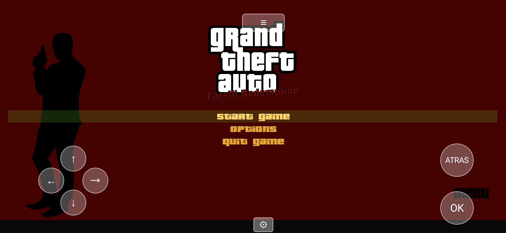
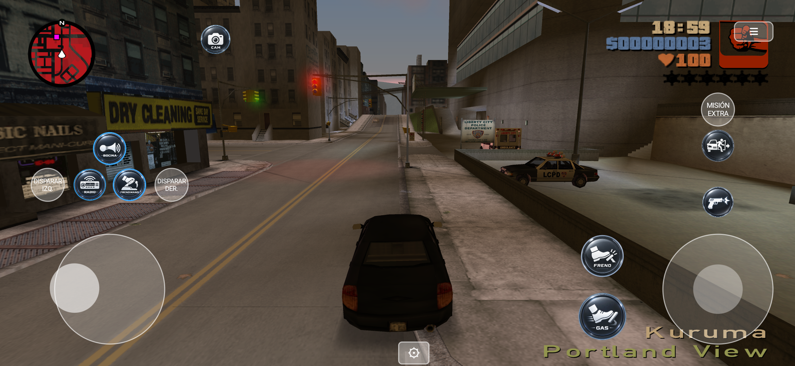

<p align="center">
  
  
</p>

<h1 align="center">re3 – Forelli Redemption (Android)</h1>

<p align="center">
  An Android port, built on top of the <a href="https://github.com/GTAmodding/re3">re3 / reVC</a> reverse-engineered engine, that runs the GTA Vice City total-conversion mod <b>"Forelli Redemption"</b> on your phone.
</p>

---

## English

### What is this?

[re3](https://github.com/GTAmodding/re3) is a community reverse-engineering of GTA III and GTA Vice City's engine — clean-room reimplemented source code, not decompiled/leaked code. This repository adds an **Android build** (`android/launcher`) with a dedicated product flavor for the *Forelli Redemption* mod, alongside the base game and other mod variants, so several can be installed side by side without stepping on each other's files or save games.

This repo contains **engine source code only**. It does **not** include any Rockstar Games or mod assets (models, textures, audio, scripts) — you need to provide those yourself from your own legally owned copy of the game and the mod.

### Screenshots

| Menu | Gameplay |
|---|---|
|  |  |

### Installing (just want to play)

1. Download the APK from the [Releases](../../releases) page and install it on your phone.
2. Get the **Forelli Redemption** mod files yourself (you need a legally owned copy of GTA Vice City + the mod installed on PC first).
3. Copy the mod's game folder contents (`anim`, `audio`, `data`, `models`, `movies`, `neo`, `scripts`, `text`, `txd`, plus `gamecontrollerdb.txt`) into a folder named **`re3-forelliredemption`** at the root of your phone's internal storage (e.g. `Internal storage/re3-forelliredemption`). You can skip the Windows-only files (`.exe`, `.dll`, `.ini`, `.asi`) — the Android engine doesn't use them.
4. Open the app and grant the "All files access" permission when asked.
5. Saves are stored independently, under `re3-forelliredemption/userfiles/` — they won't collide with the base game or other mod variants installed at the same time.

### Building it yourself

- Requires Android Studio (SDK + NDK, see `android/launcher/app/build.gradle` for exact versions) and a JDK compatible with Gradle 8.11.
- Open `android/launcher` in Android Studio, or build from the CLI:
  ```
  cd android/launcher
  ./gradlew assembleForelliRelease
  ```
- The product flavors are defined in `android/launcher/app/build.gradle`:
  - `standard` — base re3/reVC game, folder `re3GTA`
  - `fwr` — Frosted Winter Remastered mod, folder `re3GTA_FWR`
  - `forelli` — Forelli Redemption mod, folder `re3-forelliredemption`

### What's different from upstream re3

- The `android/launcher` app itself (single-activity SDL2 launcher, touch controls, per-flavor branding/storage — see comments in `GameActivity.java`).
- A texture-conversion fix in `vendor/librw` (`d3d.cpp`/`raster.cpp`): the D3D8→Image raster converter didn't handle the `C565`, `C4444` and `LUM8` raw (non-DXT) formats, which crashed the very first texture-cache build on any mod shipping textures in those formats.
- A script-interpreter safety net (`src/control/Script.cpp`): if a script's bytecode ever desyncs from what the opcode table expects (seen with one of this mod's cutscene scripts, most likely an unsupported/CLEO-style opcode), that one script now retires itself cleanly instead of dereferencing garbage and crashing the whole game.

### Credits

- [GTAmodding/re3](https://github.com/GTAmodding/re3) and [aap/librw](https://github.com/aap/librw) — the reverse-engineered engine and rendering library this is built on.
- The *Forelli Redemption* mod authors, for the total conversion this port targets.
- Rockstar Games, for the original Grand Theft Auto: Vice City.

---

## Español

### ¿Qué es esto?

[re3](https://github.com/GTAmodding/re3) es una reingeniería inversa comunitaria del motor de GTA III y GTA Vice City — código reescrito desde cero a partir de ingeniería inversa, no código decompilado ni filtrado. Este repositorio agrega un **build para Android** (`android/launcher`) con una variante dedicada para el mod *Forelli Redemption*, que convive con el juego base y otras variantes de mods instaladas al mismo tiempo, sin pisarse los archivos ni las partidas guardadas.

Este repo contiene **solo el código fuente del motor**. **No** incluye ningún asset de Rockstar Games ni del mod (modelos, texturas, audio, scripts) — esos los tenés que poner vos, desde tu propia copia legal del juego y del mod.

### Capturas

| Menú | Gameplay |
|---|---|
|  |  |

### Instalar (si solo querés jugar)

1. Descargá el APK desde la sección [Releases](../../releases) e instalalo en tu celular.
2. Conseguí vos los archivos del mod **Forelli Redemption** (necesitás una copia legal de GTA Vice City con el mod instalado en PC).
3. Copiá el contenido de la carpeta de datos del mod (`anim`, `audio`, `data`, `models`, `movies`, `neo`, `scripts`, `text`, `txd`, más `gamecontrollerdb.txt`) a una carpeta llamada **`re3-forelliredemption`** en la raíz del almacenamiento interno del celular (ej. `Almacenamiento interno/re3-forelliredemption`). Podés omitir los archivos de Windows (`.exe`, `.dll`, `.ini`, `.asi`) — el motor de Android no los usa.
4. Abrí la app y concedé el permiso "Todos los archivos" cuando lo pida.
5. Las partidas guardadas quedan en una carpeta independiente, `re3-forelliredemption/userfiles/` — no se mezclan con el juego base ni con otras variantes de mod instaladas a la vez.

### Compilarlo vos mismo

- Necesitás Android Studio (SDK + NDK, ver versiones exactas en `android/launcher/app/build.gradle`) y un JDK compatible con Gradle 8.11.
- Abrí `android/launcher` en Android Studio, o compilá por consola:
  ```
  cd android/launcher
  ./gradlew assembleForelliRelease
  ```
- Las variantes (product flavors) están definidas en `android/launcher/app/build.gradle`:
  - `standard` — juego base re3/reVC, carpeta `re3GTA`
  - `fwr` — mod Frosted Winter Remastered, carpeta `re3GTA_FWR`
  - `forelli` — mod Forelli Redemption, carpeta `re3-forelliredemption`

### Qué es distinto respecto al re3 original

- La app `android/launcher` en sí (launcher SDL2 de una sola activity, controles táctiles, marca/almacenamiento por variante — ver comentarios en `GameActivity.java`).
- Un arreglo de conversión de texturas en `vendor/librw` (`d3d.cpp`/`raster.cpp`): el conversor de raster D3D8→Image no soportaba los formatos crudos (sin DXT) `C565`, `C4444` y `LUM8`, lo que crasheaba la primera conversión de texturas apenas arrancaba, en cualquier mod que trajera texturas en esos formatos.
- Una red de seguridad en el intérprete de scripts (`src/control/Script.cpp`): si el bytecode de un script se desincroniza de lo que espera la tabla de opcodes (visto en uno de los scripts de cinemática de este mod, probablemente un opcode no soportado o al estilo CLEO), ese script se retira solo de forma limpia en vez de leer memoria basura y crashear todo el juego.

### Créditos

- [GTAmodding/re3](https://github.com/GTAmodding/re3) y [aap/librw](https://github.com/aap/librw) — el motor de ingeniería inversa y la librería de renderizado sobre los que está construido esto.
- Los autores del mod *Forelli Redemption*, por la conversión total que este port acompaña.
- Rockstar Games, por el Grand Theft Auto: Vice City original.
